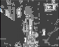
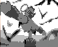
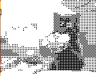
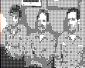
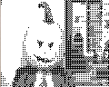
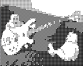
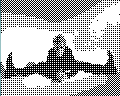

<h1>Reproducir video RCA desde dos Arduinos</h1>

Este proyecto genera una señal de video RCA utilizando dos Arduinos: uno de ellos está conectado a un <a href="http://www.arduino.cc/en/Reference/SD">lector de tarjeta SD</a> con su respectiva librería, mientras que el otro genera la señal de video mediante la librería <a href="https://github.com/Avamander/arduino-tvout/">TVout</a>. Ambos se comunican mediante protocolo I2C y emplean un pin adicional como señal de control para pausar y reanudar la transmisión de datos.

Para hacer funcionar el proyecto se requiere trabajar con tres componentes principales, el Arduino emisor (conectado al lector SD), el Arduino receptor conectado al conector RCA macho y un <em>sketch</em> de Processing que realiza el postprocesamiento de la imagen para adaptarla a la resolución de la librería TVout y exportar los fotogramas a la tarjeta SD en formato binario (.BIN).

<h3>Conexiones de los Arduinos</h3>

>[!WARNING]
>El autor de este proyecto utilizó un Arduino Uno equipado con un <em>shield</em> de tarjeta SD, por lo que las conexiones del lector en el diagrama son referenciales. Asimismo, al utilizar un Arduino Nano que carece de pines físicos SDA y SCL dedicados, se emplearon los pines analógicos A4 y A5. Tome este diagrama como guía, verifique el pinout real de su lector de tarjetas y asegure la correcta asignación de los pines SDA/SCL. Tenga en cuenta también que la librería TVout reserva por defecto los pines digitales D7 y D9 para la generación de video, el pin de control o semáforo puede ubicarse en cualquier otro pin digital disponible.

<h3>Postprocesamiento de la imagen</h3>

Como es sabido por quienes han utilizado la librería TVout, la señal de video generada es estrictamente monocromática, 1 bit por píxel, blanco o negro. También cuenta con una resolución máxima de 120 x 96 píxeles. Por esta razón, si se desea reproducir video capturado por una cámara u otro medio, es necesario aplicar un preprocesamiento cromático para asegurar la legibilidad de la imagen.

Dentro de la carpeta <code>video_sd</code> se incluye un archivo de Processing con funciones orientadas a redibujar el contenido, ya sea mediante el método <code>draw()</code> o utilizando un búfer gráfico <code>PGraphics</code>, aplicando una técnica de tramado (<em>dithering</em>) basada en la matriz de Bayer. Este filtro genera un patrón de cuadrículas blancas y negras que simula una escala de grises mediante versiones de matrices de 2x2, 4x4 y 8x8. Se recomienda utilizar imágenes con alto contraste y bajo nivel de detalle para optimizar la visualización.

Para implementarlo en tu <em>sketch</em>, puedes generar formas, cargar imágenes o utilizar la librería de video habitual. Al final del bloque de dibujo, simplemente invoca alguna de las funciones de tramado, <code>bayer2x2()</code>, <code>bayer4x4()</code> o <code>bayer8x8()</code>. Estas funciones aceptan hasta tres parámetros, dos de ellos obligatorios:

<ul>
  <li><b>La imagen a procesar</b>. Como buena práctica, debe ajustarse a las dimensiones correctas, puedes usar <code>get(0, 0, width, height)</code> o simplemente <code>get()</code> para capturar lo dibujado hasta ese momento.</li>
  <li><b>Tamaño del pixel</b>. Para estas resoluciones, el valor óptimo es 1.</li>
  <li><b>Búfer de imagen</b> (opcional) donde se desea renderizar. Omitir este tercer parámetro y usar solo dos variables funciona perfectamente.</li>
</ul>

A continuación se muestran algunos ejemplos de cómo deben lucirse las imágenes resultantes:

 

<h3>Guardado de fotogramas</h3>

Para este propósito se incluye en la misma carpeta un archivo llamado <code>videoExporter</code> que contiene la clase homónima. Este objeto debe inicializarse en el método <code>setup()</code> pasando como parámetro un <code>String</code> con el nombre deseado para el archivo de salida, el cual se generará siempre con la extensión <code>.BIN</code>.

El registro de los fotogramas debe realizarse de manera secuencial, idealmente al final del ciclo de dibujo o inmediatamente después de aplicar la función de tramado Bayer. Para ello, se invoca el método <code>addFrame()</code> pasando la captura actual del lienzo mediante <code>get(0, 0, width, height)</code> o <code>get()</code>, como ejemplo <code>exporter.addFrame(get());</code>).

Es de vital importancia cerrar correctamente el archivo al finalizar la captura, ya sea mediante una condición <code>if</code>, un evento de teclado <code>keyPressed()</code>, de mouse <code>mousePressed()</code> o similares, aplicando la función <code>finish()</code> al objeto exportador. Omitir este paso puede provocar la corrupción de los datos o que el archivo no se guarde adecuadamente.

<h3>Muestra de su funcionamiento</h3>
