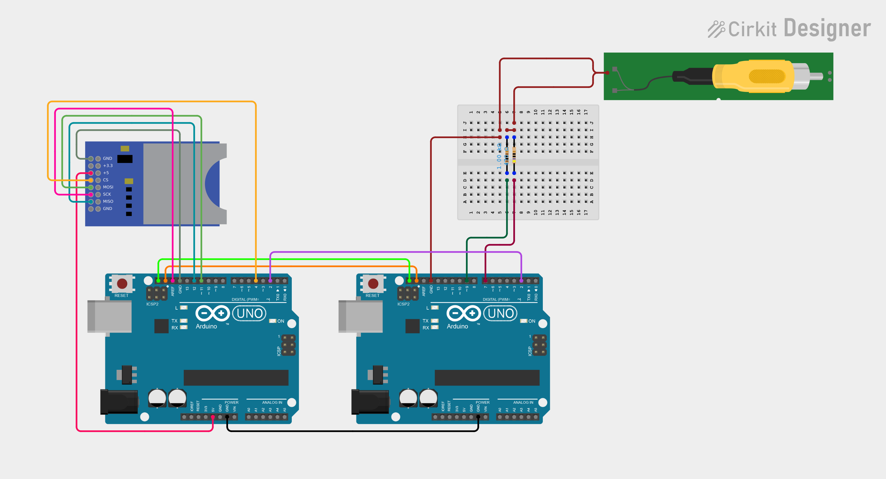

#Reproducir video RCA desde dos Arduinos

Este proyecto genera una señal de video RCA desde dos arduinos, uno está conectado un lector de tarjeta SD con su respectiva <a href="http://www.arduino.cc/en/Reference/SD">librería</a>, el otro genera la señal de video mediante la librería <a href="https://github.com/Avamander/arduino-tvout/">TVout</a>. Ambos se conectan mediante comunicación I2C y un pin en modo de semáforo para parar y continuar la comunicación.

Por otro lado, si ya conoces algo de la librería TVout sabrás que la señal de video que se produce tiene solo pixeles de un bit, solo blanco y negro, además de que la resolución máxima es de 120 x 96 pixeles, por lo cual si quieres tener un video grabado deberías por lo menos hacerle un post-procesado para que se pueda entender la imagen. Por esto, dentro de los archivos deje un archivo de Processing con funciones que dibujan en el void draw() o en el buffer que se le indique la imagen entregada con un filtro bayer o "bit map", está en sus versiones 2x2, 4x4 y 8x8.

